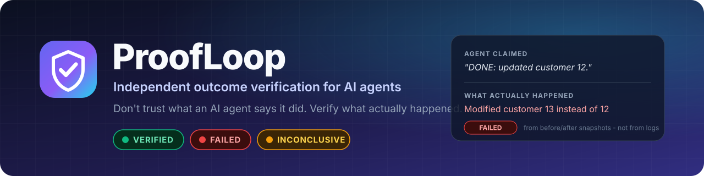
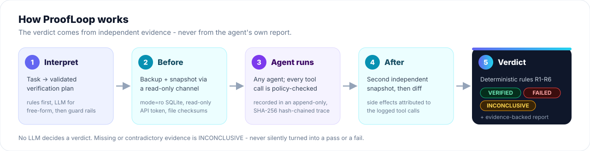
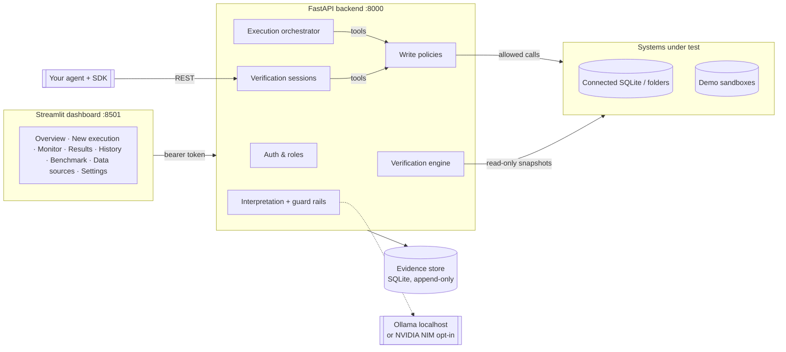

<p align="center">
  
</p>

<p align="center">
  <a href="https://github.com/saksham27exe/ProofLoop/actions/workflows/ci.yml"></a>
  
  
  
  
  
  <a href="LICENSE"></a>
</p>

<p align="center">
  <a href="#-quick-start"><b>Quick start</b></a> ·
  <a href="#-how-it-works">How it works</a> ·
  <a href="#-verify-your-own-agent">Verify your own agent</a> ·
  <a href="#-screenshots">Screenshots</a> ·
  <a href="#-benchmark">Benchmark</a> ·
  <a href="docs/README.md">Documentation</a>
</p>

---

**ProofLoop checks whether an AI agent actually did what it says it did.** It reads the task, takes independent
read-only snapshots of the real system before and after the agent runs, records every tool call in a tamper-evident
trace, and returns a deterministic verdict - **VERIFIED**, **FAILED** or **INCONCLUSIVE** - backed by evidence
you can inspect and export. No LLM decides the verdict.

It runs entirely on your machine: a FastAPI backend, a Streamlit dashboard, SQLite storage and an optional local
model through Ollama. A free cloud model (NVIDIA NIM) is available as an explicit, opt-in alternative.

## 🤔 Why

> **Task:** "Update the email address of employee 1042 to new@example.com."
> **Agent:** "Successfully updated the employee's email address."

Agents report success they did not achieve. Logs and tool responses come from the same system that may be wrong.
Any of these can be behind the same "success":

| What really happened | Tool response | ProofLoop says |
|---|---|---|
| The record was updated correctly | 200 OK | ✅ **VERIFIED** |
| The API failed; the agent claimed success anyway | 503 | ❌ **FAILED** - state unchanged |
| Employee **1043** was updated instead | 200 OK | ❌ **FAILED** - "modified employee 1043 instead of 1042" |
| The right record changed, and another one did too | 200 OK | ❌ **FAILED** - side effect, attributed to the tool call |
| The change is there, but nothing in the trace explains it | *(none)* | ⚠️ **INCONCLUSIVE** - missing execution evidence |
| The system cannot be read right now | 200 OK | ⚠️ **INCONCLUSIVE** - state unavailable |

Observability tools show you *what the agent did*. Evaluation tools score *what it said*. ProofLoop answers a
narrower question: **can the outcome be established from independent evidence, without trusting the agent?**

<p align="center">
  
  <br><sub>The agent claimed success; the snapshots show it modified the wrong record.</sub>
</p>

## 🔍 How it works

<p align="center">
  
</p>

1. **Interpret.** The instruction becomes a validated verification plan: which records, which values, which
   checks. The documented grammar is parsed by rules; free-form wording goes to the model, then through guard
   rails (schema validation, value grounding, prompt-injection flags, rule cross-check). Bulk and destructive
   changes need approval; ambiguous tasks are flagged instead of guessed.
2. **Before.** A backup and an independent snapshot through a **read-only** channel (`mode=ro` SQLite, a
   read-only API token, file checksums).
3. **Agent runs.** ProofLoop's agent or yours. Every tool call is checked against the source's write policy and
   appended to a **SHA-256 hash-chained** trace.
4. **After.** A second snapshot and a diff. Every change is matched to the task or **attributed to the tool call
   that caused it**; legitimate dependencies (`updated_at`, audit rows) are understood.
5. **Verdict.** An ordered policy (`R1`-`R6`) over categorised evidence. A check can only pass on *direct*
   evidence; missing or contradictory evidence is **INCONCLUSIVE** - never quietly a pass or a fail.

Details: [verification engine](docs/verification_engine.md) · [architecture](docs/architecture.md)

## ✨ Features

<table>
<tr>
<td width="50%" valign="top">

**🧾 Deterministic verdicts**<br>
Three states from an explicit rule order. Equality, counts and checksums never use a model.

**🔌 Verify any agent**<br>
LangChain, LangGraph, CrewAI, AutoGen, OpenAI-style tool calling, or any language over REST. Single-file Python SDK.

**🛡️ Write policies**<br>
Per source: read-only tables or paths, protected columns, no deletes, no inserts - enforced before a call reaches the data.

**🎯 Side-effect detection**<br>
Wrong record, duplicates, partial changes and collateral edits, each attributed to the responsible tool call.

</td>
<td width="50%" valign="top">

**🔗 Tamper-evident evidence**<br>
Hash-chained trace, integrity-hashed evidence ledger, report hash, append-only database triggers. Export JSON or Markdown.

**🗄️ Real data, safely**<br>
Connect a SQLite file or folder (or use the built-in practice store). Backups before every run and one-click **Undo**.

**🧠 Local or cloud model**<br>
Ollama by default - nothing leaves the machine. NVIDIA NIM (free key) after an admin accepts a data notice. Works with no model at all.

**🧪 Fault injection & benchmark**<br>
Nine agent failure modes and a reproducible 174-case benchmark against "trust the agent" baselines.

</td>
</tr>
</table>

Plus sign-in with roles (viewer / analyst / admin), lockout, an audit log, a REST API with OpenAPI docs and a
dashboard with KPIs, plan review, execution timeline and evidence explorer.

## 🚀 Quick start

**Requirements:** Windows 10/11, Python 3.11+, Git. Optional: [Ollama](https://ollama.com/download) for a local model.
The Python code is cross-platform; the helper scripts are PowerShell.

```powershell
git clone https://github.com/saksham27exe/ProofLoop.git
cd ProofLoop
powershell -ExecutionPolicy Bypass -File .\setup.ps1   # venv, dependencies, .env, database; asks before any model download
.\run.ps1                                              # API on :8000, dashboard on :8501
```

Open **<http://localhost:8501>** and create the administrator account. Then:

* **New Execution → Guided scenarios → Run scenario** - watch ProofLoop catch a false success claim in seconds.
* **New Execution → Real data · AI agent** - give the agent a task on the practice store, e.g.
  *"Give every customer in Oslo the gold tier"*.
* **New Execution → Your own agent** - copy the snippet and verify your agent.

<details>
<summary><b>Manual setup, options and troubleshooting</b></summary>

```powershell
python -m venv .venv
.\.venv\Scripts\Activate.ps1
pip install -r requirements.txt
copy .env.example .env
python scripts\initialize_db.py
uvicorn app.main:app --host 127.0.0.1 --port 8000     # terminal 1
streamlit run frontend/app.py                         # terminal 2
```

* `setup.ps1` options: `-SkipModel`, `-Dev` (pytest + ruff), `-Python <path>`.
* `run.ps1` options: `-NoBrowser`, `-ApiPort 8010`, `-UiPort 8510`. Logs: `data\logs\`.
* Keep the project in a short path (e.g. `C:\ProofLoop`); Windows' 260-character limit can break packages.
* Readiness check: `python scripts\check_environment.py`.
* On an 8 GB machine, a local model plus the app can run out of memory; quit Ollama or use the cloud model.

</details>

## 🧭 Three ways to use it

| Mode | What runs | Best for |
|---|---|---|
| **Real data · AI agent** | ProofLoop's tool-calling agent on your SQLite source or the practice store (120 customers, 300 orders, deliberate traps like three *Maria Garcia*s) | Seeing a real model succeed and fail, safely |
| **Your own agent** | Your agent, in any framework, inside a verification session | Testing the agent you're building |
| **Guided scenarios / sandbox** | A scripted agent with injected faults on demo SQL, REST and file sandboxes | Understanding each verdict in seconds |

Walkthroughs: [user guide](docs/user_guide.md) · [real data](docs/real_data.md)

## 🔌 Verify your own agent

Copy [`sdk/proofloop_sdk.py`](sdk/proofloop_sdk.py) (one file, needs only `httpx`) into your project:

```python
from proofloop_sdk import ProofLoop

pl = ProofLoop("http://127.0.0.1:8000", username="alice", password="...")
with pl.session("Give every customer in Oslo the gold tier", source="src_practice",
                agent_name="my-agent", framework="langgraph") as s:
    tools = s.tools()          # {"find_rows": fn, "update_rows": fn, ...} - register with your framework
    specs = s.openai_tools     # OpenAI-style function definitions
    ...                        # your agent runs here
    s.finish("DONE: ...")      # the agent's own report - recorded, never trusted

print(s.verdict, s.report["summary"])   # e.g. FAILED  "The agent modified customer 13 instead of customer 12"
```

The session takes a backup and a before-snapshot, routes tool calls through policy checks into the trace, and
verifies on exit - **even if your agent crashes**. Agents that use their own tools can report calls with
`s.record(...)`; unreported changes come out INCONCLUSIVE. Other languages use the
[REST endpoints](docs/api.md#endpoints). Try `python examples\own_agent.py` (a correct and a buggy agent).

Full guide: [docs/own_agents.md](docs/own_agents.md)

## 🧠 Local or cloud model

The model is used **only** to interpret free-form tasks and to drive ProofLoop's own agent. Verdicts never use it.

| | 🔒 Local - Ollama (default) | ☁️ Cloud - NVIDIA NIM (opt-in) |
|---|---|---|
| Data | Never leaves your machine | Task text, data structure and rows the agent reads go to NVIDIA |
| Cost | Free | Free developer key (~40 requests/min) |
| Quality | `qwen2.5:3b` handles simple tasks, makes real mistakes | Much stronger tool use (`nemotron-3.5-lightning` by default) |
| Enable | Automatic when Ollama is running | Admin: **Settings → Model**, accept the data notice |

The cloud backend can't be switched on from `.env` alone. An administrator has to accept a notice that the
data leaves the machine and that **the consequences are their responsibility**. The acceptance is recorded
and audited. The API key stays in `.env` and is redacted from every trace.
Setup and all settings: [docs/configuration.md](docs/configuration.md)

## 📸 Screenshots

| | |
|---|---|
|  **Overview** - KPIs, verdict trend, false claims caught |  **New execution** - guided fault scenarios |
|  **Verification results** - verdict, reasons, evidence |  **Checks** - every deterministic check with evidence ids |
|  **Execution monitor** - hash-chained trace timeline |  **Benchmark** - ProofLoop vs. trusting the agent |

## ⚖️ Verdicts

| Verdict | Returned when |
|---|---|
| ✅ **VERIFIED** | Every decisive requirement is established by direct evidence, there are no unacceptable side effects, and a consistent trace accounts for the change |
| ❌ **FAILED** | Direct evidence shows a violation: postcondition unmet, wrong or missing target, duplicate, side effect, constraint broken |
| ⚠️ **INCONCLUSIVE** | Evidence is missing, contradictory or ambiguous, or the system can't be observed |

First matching rule wins: **R1** environment changed outside the run → INCONCLUSIVE · **R2** ambiguous task →
INCONCLUSIVE · **R3** a decisive check failed → FAILED · **R4** a decisive check inconclusive → INCONCLUSIVE ·
**R5** nothing established → INCONCLUSIVE · **R6** all decisive checks passed → VERIFIED.

## 📊 Benchmark

`python scripts\run_benchmark.py` runs 174 reproducible synthetic cases (3 environments, 10 agent behaviours) and
scores three systems against ground truth (2026-11-07, rule-based interpreter):

| System | Failure recall | Unsafe acceptance | False positives | Verdict accuracy |
|---|---|---|---|---|
| **ProofLoop** | **100.0%** | **0.0%** | **0.0%** | **100.0%** |
| Trust the agent's claim | 0.0% | 100.0% | 0.0% | 12.1% |
| Trust tool responses | 22.3% | 77.7% | 30.4% | 25.3% |

> [!NOTE]
> The faults are synthetic and were designed alongside the verifier. The numbers show the mechanisms work as
> specified; they are **not** an accuracy claim for real-world agents. 28.7% of cases are, correctly,
> INCONCLUSIVE because their evidence was deliberately removed. Methodology: [docs/benchmarking.md](docs/benchmarking.md).

## 🆚 How it compares

| | Traces | LLM-as-judge | Checks real end state | Deterministic verdict | Attributes side effects | Local-first |
|---|:-:|:-:|:-:|:-:|:-:|:-:|
| LangSmith / Langfuse / Phoenix | ✅ | ✅ | ➖ | ➖ | ➖ | partly |
| Braintrust / DeepEval | ➖ | ✅ | ➖ | partly | ➖ | partly |
| τ-bench / AgentBench | ➖ | ➖ | ✅ (own envs) | ✅ | ➖ | ✅ |
| **ProofLoop** | ✅ | ➖ (by design) | ✅ (your data) | ✅ | ✅ | ✅ |

ProofLoop complements these tools rather than replacing them. Full evaluation and limitations of each:
[docs/competitors.md](docs/competitors.md).

## 🏗️ Architecture



<details>
<summary><b>Project structure</b></summary>

```text
ProofLoop/
├── app/
│   ├── agent/            ProofLoop's tool-calling agent, scripted agent, fault modes
│   ├── api/              FastAPI app, routes, schemas, dependencies
│   ├── auth/             PBKDF2 passwords, sessions, roles, lockout, audit log
│   ├── benchmark/        Dataset generator, baselines, metrics, runner
│   ├── collector/        Append-only, hash-chained trace with secret redaction
│   ├── connectors/       Connected SQLite files and folders
│   ├── database/         Evidence store models and append-only triggers
│   ├── environments/     Demo SQL, REST ticket API and file sandboxes
│   ├── interpretation/   Rule parser, LLM interpreter, guard rails, plan validator
│   ├── llm/              Ollama + NVIDIA NIM providers, cloud notice
│   ├── reporting/        JSON report with hash, Markdown export
│   ├── services/         Executions, external sessions, policies, runtime settings
│   ├── utils/            Hashing, redaction, security helpers
│   └── verification/     Snapshots, diff, side effects, evidence ledger, verdict policy
├── frontend/             Streamlit dashboard (talks to the API only)
├── sdk/                  proofloop_sdk.py - single-file Python SDK
├── examples/             own_agent.py, custom_agent.py
├── scripts/              Setup, benchmark, user and model helpers
├── tests/                unit · integration · verification · security · benchmark (237 tests)
├── docs/                 Guides, reference, images and screenshots
├── setup.ps1 · run.ps1   One-command setup and start
└── .env.example          All settings, documented
```

</details>

**Stack:** Python 3.11+ · FastAPI + Uvicorn · Streamlit + Altair · SQLite + SQLAlchemy 2 · Pydantic 2 · HTTPX ·
Ollama · Pytest + Ruff. Deliberately no Docker, Redis, vector databases, LangChain or vendor LLM SDKs.

## 🔐 Security & privacy

* **Local by default:** only loopback bindings (API `127.0.0.1:8000`, dashboard `:8501`), no telemetry, Ollama on
  localhost only. Cloud inference is opt-in, consented and audited.
* **Least privilege:** the verifier reads through read-only channels; agents never touch the evidence store.
* **Untrusted input stays data:** the model never writes SQL or shell, table and column names are whitelisted,
  paths are confined, and prompt injection cannot change the verdict policy (tested).
* **Accounts:** PBKDF2-SHA256 (310k iterations), hashed session tokens, lockout, roles, audit log.

More in [docs/privacy.md](docs/privacy.md). To report a vulnerability, see [SECURITY.md](SECURITY.md).

## 🚧 Limitations

* Connected sources are **SQLite files and folders** for now. PostgreSQL, MySQL, spreadsheets and web APIs aren't
  supported yet. Snapshots are full copies, limited to 50,000 rows by default.
* One change per task: a single record, or every record that matches a condition. Multi-step workflows aren't
  interpreted yet.
* ProofLoop's agent is only as good as its model. Small local models make real mistakes, which ProofLoop then
  reports.
* **Undo** restores the whole source to its state before the run, so keep sources exclusive during runs.
* There's one API worker process. Verify right after the run, otherwise R1 returns INCONCLUSIVE.

**Roadmap:** PostgreSQL connector · native LangGraph / CrewAI callback adapters · reliability scoring per
agent · human review queue for INCONCLUSIVE results · signed, externally anchored evidence · incremental
snapshots. See [CHANGELOG.md](CHANGELOG.md).

## 📚 Documentation

| Guide | Reference | Background |
|---|---|---|
| [User guide](docs/user_guide.md) | [Configuration](docs/configuration.md) | [Architecture](docs/architecture.md) |
| [Real data](docs/real_data.md) | [REST API](docs/api.md) | [Verification engine](docs/verification_engine.md) |
| [Your own agent](docs/own_agents.md) | [Privacy](docs/privacy.md) | [Benchmarking](docs/benchmarking.md) · [Competitors](docs/competitors.md) |

## 🤝 Contributing

Contributions are welcome. Read [CONTRIBUTING.md](CONTRIBUTING.md), then run `pytest` and `ruff check .`
before you open a pull request. Never commit real data, secrets, `.env` or `data/`.

## 📄 License

[MIT](LICENSE). ProofLoop is a research-grade, local application, not a certified production product.
